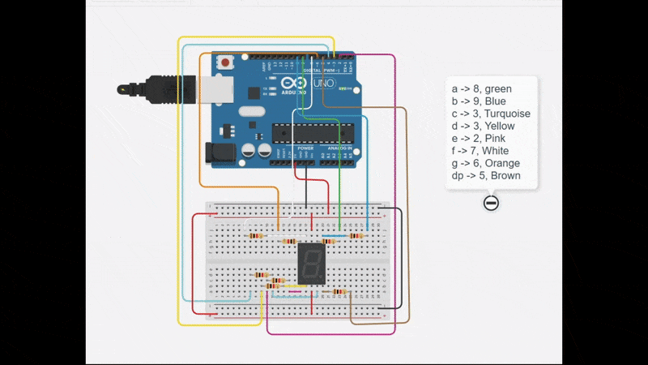

**7-Segment Display — Countdown**

- **Description:** Simple Arduino project that runs a numeric countdown on a single 7-segment display using `countdown.ino`.

**Features:**
- Easy-to-use countdown timer sketch
- Single-digit 7-segment wiring and pin mapping included
- Short notes for upload and customization

...
